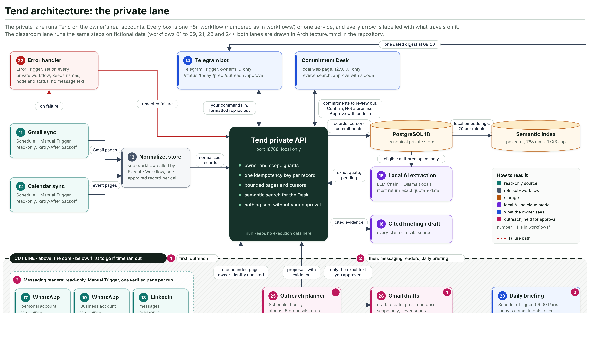
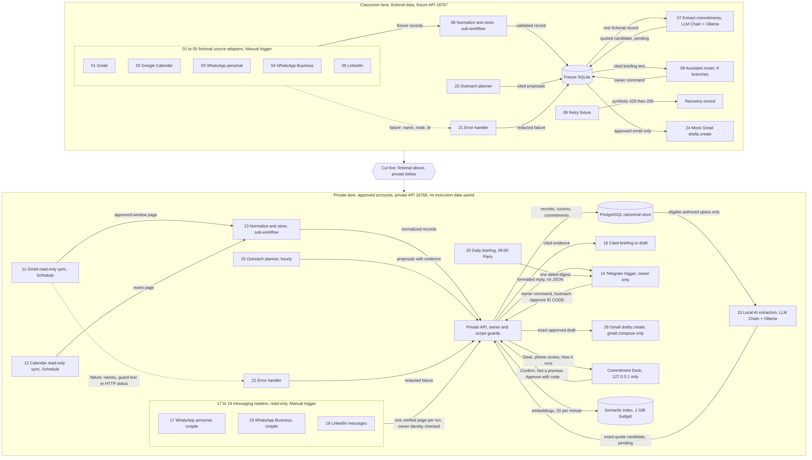

# Tend

**Need:** founders who keep their promises across Gmail, Calendar, WhatsApp and LinkedIn lose track of who owes what to whom; today they scroll back through each app by hand or rely on memory.

Tend is a set of n8n workflows plus a small local API. The workflows read messages, store them in a database, ask a local AI model (Ollama) to extract promises with an exact quote and date, and let the owner confirm, query and follow up from Telegram. Nothing is sent to a contact without the owner's explicit approval.

- Architecture diagrams: [`docs/architecture-private-lane.svg`](docs/architecture-private-lane.svg) (the private lane, with the cut line) and [`Architecture.mmd`](Architecture.mmd) (both lanes, Mermaid; GitHub renders it)
- Workflows (exported JSON, the versions used in the demo): [`workflows/`](workflows/) (01-26)
- Demo script: [`Demo-guide.txt`](Demo-guide.txt) · Full specification: [`Specification.txt`](Specification.txt)

## Workflows at a glance

| Lane                                                    | Workflows  | What they do                                                                                                    |
| ------------------------------------------------------- | ---------- | --------------------------------------------------------------------------------------------------------------- |
| Classroom (fictional data, safe to demo)                | 01-05      | Source adapters (Gmail, Calendar, WhatsApp personal and business, LinkedIn)                                     |
|                                                         | 06         | Sub-workflow called with Execute Workflow: normalize and store                                                  |
|                                                         | 07         | Local AI extraction (LLM Chain with a written system prompt), output validated against the exact quote and date |
|                                                         | 08         | Command router (If branch) and briefing                                                                         |
|                                                         | 09         | Retry fixture: synthetic 429, bounded retries                                                                   |
|                                                         | 21         | Error workflow (Error Trigger) for 01-09                                                                        |
|                                                         | 23, 24     | Outreach planner and Gmail drafts (mock Gmail)                                                                  |
| Private (owner's own accounts, saves no execution data) | 10, 14     | Telegram owner control (message trigger)                                                                        |
|                                                         | 11, 12, 13 | Read-only Gmail and Calendar sync, normalize and store                                                          |
|                                                         | 15, 16     | Local AI extraction and cited briefing or draft                                                                 |
|                                                         | 17, 18, 19 | WhatsApp personal, LinkedIn, WhatsApp business read pages                                                       |
|                                                         | 20         | Daily briefing at 09:00 Europe/Paris                                                                            |
|                                                         | 22         | Error workflow for the private lane                                                                             |
|                                                         | 25, 26     | Outreach planner and approved Gmail draft (drafts.create only)                                                  |

## Run it from a fresh clone

Requirements: Docker with Compose v2, Node 24 or Bun, and Ollama for the AI steps.

```bash
git clone <this repo> tend && cd tend
cp .env.example .env          # then set POSTGRES_PASSWORD and N8N_ENCRYPTION_KEY (openssl rand -hex 32)
docker compose up -d          # n8n 2.43.4 + PostgreSQL 16.4, both pinned; n8n waits for the database healthcheck
docker compose ps             # postgres shows "healthy", n8n "running"
docker compose exec n8n n8n import:workflow --separate --input=/workflows
```

Open http://localhost:5678, create the owner account, then create the credentials the workflows reference (placeholders named `CONFIGURE_...` in the JSON):

| Credential in n8n                              | Used by                                                     | Notes                                                                                    |
| ---------------------------------------------- | ----------------------------------------------------------- | ---------------------------------------------------------------------------------------- |
| Header Auth                                    | private workflows 11-20, 22, 25, 26 (calls to the Tend API) | `Authorization: Bearer <key>`; the key is set once on the local setup page               |
| Ollama                                         | 07, 15, 16                                                  | Local Ollama at `http://host.docker.internal:11434`                                      |
| Telegram API                                   | 10, 14, 16, 20                                              | Bot token from BotFather; owner chat only                                                |
| Gmail OAuth2 API (read-only)                   | 11, 12                                                      | Google app in Testing mode                                                               |
| Google Calendar OAuth2 API                     | 12                                                          | read-only                                                                                |
| Gmail OAuth2 API "Gmail drafts (compose only)" | 26                                                          | Custom Scopes on, Enabled Scopes exactly `https://www.googleapis.com/auth/gmail.compose` |

Workflows and data live in the named volumes `tend_n8n_data` and `tend_postgres_data`, so `docker compose down` then `docker compose up -d` keeps everything.

### Environment variables (`.env`)

| Variable                                            | Purpose                                                     |
| --------------------------------------------------- | ----------------------------------------------------------- |
| `POSTGRES_USER`, `POSTGRES_PASSWORD`, `POSTGRES_DB` | Database n8n uses for workflows, credentials and executions |
| `N8N_ENCRYPTION_KEY`                                | Encrypts stored credentials; keep it safe                   |
| `N8N_PORT`                                          | Host port for the editor (default 5678)                     |
| `GENERIC_TIMEZONE`                                  | Schedules run in this time zone (default Europe/Paris)      |

The Tend API also reads `OUTREACH_ENABLED` (default `false`: approvals never create Gmail drafts).

### Local Tend API

```bash
bun install
bun run start                 # fictional fixture API on http://localhost:18767
```

## How to test

```bash
bun run verify                # typecheck, lint, unit tests, workflow build, formatting
bun run integration           # imports the workflows into a throwaway n8n container and runs them end to end
```

Manual checks in the editor:

- Triggers fire on demand: classroom workflows 01-09 start from a Manual Trigger, and the private syncs 11, 12 and 15 have a Manual Trigger next to their schedule. Open one and click **Execute workflow**.
- Unknown or malformed commands to the bot return the usage message (`/help`).
- Workflow 09 shows bounded retries recovering on attempt three.
- Forcing a failure (bad URL) in a classroom workflow fires workflow 21, which records the workflow name, node and execution ID.

## Security

- No secrets in Git: `.env` and `.scratch/` are ignored; workflow JSON only carries credential placeholders.
- Private workflows save no execution data, success or error.
- Outreach is approve-before-send: every draft needs the owner's yes on the exact text, and n8n only ever creates Gmail drafts.

## Screenshots

Private lane, on the owner's real accounts (source [`docs/architecture-private-lane.svg`](docs/architecture-private-lane.svg)); the dashed line is the cut line, with what would have been cut first below it:



Both lanes (rendered from `Architecture.mmd`; level 2, fictional classroom lane on top, private lane below):


